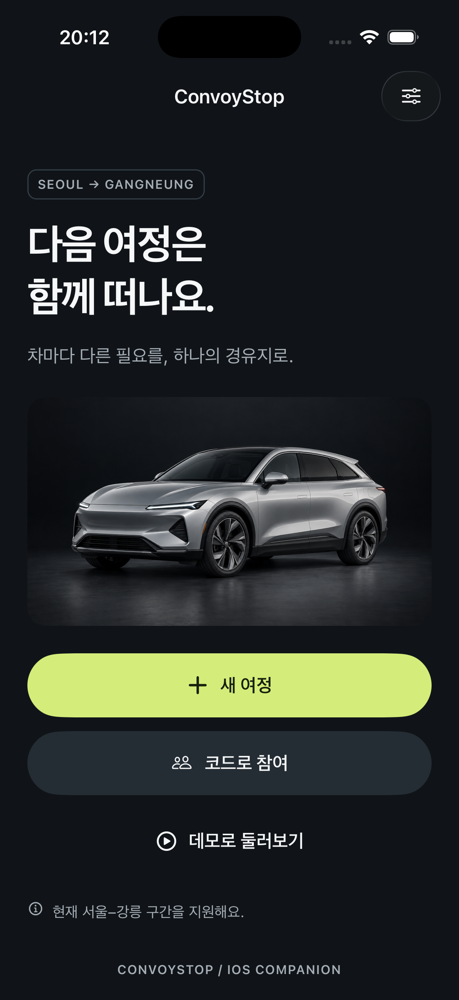

# ConvoyStop

여러 차량의 충전·주유와 동승자 요구를 함께 비교하고, 전원 합의한 경유지를 공유하는 동행 이동 앱의 iOS 프로토타입입니다.

An iOS-first React Native companion for cars traveling together. Each car shares its needs, the server compares stops for the whole group, and every car decides before a stop is agreed.

Korean is the default language. English and light/dark/system appearance are available in Settings. No account is required.

## Reviewer quick start

This repository contains the iOS companion, the local group server, shared domain logic and tests. The implemented prototype uses manual/demo vehicle data and illustrative stops. A separate Pleos Connect / Android Automotive client remains planned; no release APK is included in this version.

- [Watch the final simulator demo](evidence/recordings/07-persistent-root-release.mov), approximately 2 minutes 39 seconds.
- [Review the evidence index](evidence/README.md) and [verification status](docs/PROGRESS.md).
- [Read the platform boundaries and competition requirements](docs/PLATFORM.md).
- Follow the local run instructions below, then choose **데모로 둘러보기** to exercise the complete group flow.



## Run locally

Requirements: Node 22+, npm, Xcode with an iOS Simulator, CocoaPods. This checkout was verified with Node 22.23.2, Xcode 26.4.1, Expo SDK 58 and React Native 0.88.

```sh
npm ci
npm run server:start
```

In another terminal:

```sh
npm run ios -w @convoy/mobile -- --device "iPhone 17 Pro"
```

A standalone simulator release includes its JavaScript bundle:

```sh
npm run ios -w @convoy/mobile -- --configuration Release --device "iPhone 17 Pro" --no-bundler
```

The native iOS project and Podfile.lock are included. After changing app configuration or native dependencies, regenerate with `npx expo prebuild --platform ios` from `apps/mobile`, then rebuild. Do not edit generated native files without recording the reason in docs/ARCHITECTURE.md.

The server listens on `http://127.0.0.1:8787`. SQLite data lives in `.runtime/convoystop.sqlite`. Start the server from the repository root so the database path stays consistent. Restarting the server preserves trips. Invite codes expire after 24 hours; old records and receipts are pruned after a retention window at startup.

For a physical iPhone or multiple computers, run the server on a trusted LAN with `HOST=0.0.0.0 npm run server:start`. Enter that Mac's LAN address in the app's Settings before joining a trip. Everyone must use the same server. The app does not need location permissions. The checked-in configuration permits HTTP for local testing; a public deployment needs HTTPS/WSS and removal of the broad local-development ATS exception before distribution.

## Try the whole flow

Tap **데모로 둘러보기**, create the trip, select needs, find a stop, propose it and approve. The explicitly labeled demo controls let the second car approve, decline or arrive through the same server state machine. Open Apple Maps, return, confirm your own arrival, then the demo car's arrival, and finish the trip.

For two real clients, create a trip on one iPhone and enter its six-character code on another. One simulator plus an automated client is also supported:

```sh
npm run peer -- create
# Enter the printed code in the iOS app using 코드로 참여.
npm run peer -- propose munmak
npm run peer -- reject
npm run peer -- propose hoengseong
# Approve in the iOS app, then:
npm run peer -- approve
# Confirm your arrival in the iOS app, then:
npm run peer -- arrive
npm run peer -- finish
```

The peer script is a local testing client. It stores its disposable credential in ignored `.runtime/peer.json` and prints no token. It does not simulate Maps guidance.

## Checks and evidence

```sh
npm run verify
npm run format
```

Domain and API tests cover group ranking, mandatory services and connectors, stale versions, concurrent approvals, rejection, individual navigation attempts, individual arrivals, authorization, idempotency, WebSocket updates and SQLite restart persistence.

See [verification status](docs/PROGRESS.md), [recordings and screenshots](evidence/README.md), [product scope](docs/PRODUCT.md), [architecture](docs/ARCHITECTURE.md), and [design decisions](docs/DESIGN.md). AGENTS.md is the durable entry point for future work.

## Data boundaries

- Vehicle values come from manual input or an explicitly labeled demo provider. No live Kia telemetry, percentage-to-range calculation or arrival guarantee.
- Stops cover the Seoul–Gangneung corridor. Coordinates are approximate; services, connector availability, accessibility and additional minutes are illustrative fixtures. Verify actual conditions before traveling.
- Apple Maps opening is tracked per car. It does not mean guidance started. Arrival is user-confirmed.
- This is an independent product. Pleos Connect targets Android Automotive OS and needs a separate future native integration. This iOS companion is not an Android Automotive contest APK.
- The backend runs locally. It has not been published or configured for public production hosting.

The final root-state flow is `evidence/recordings/07-persistent-root-release.mov`. Known tooling and public-release constraints are in [security and deployment notes](docs/SECURITY.md).
